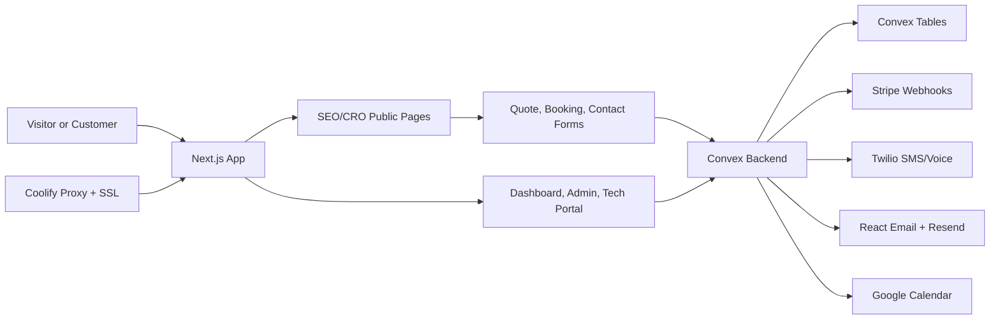

# Elite Irrigation & Landscaping

Elite Irrigation & Landscaping is a production-focused outdoor property services platform for the Charlotte metro. It combines a public SEO/CRO website, problem finder, quote and booking flows, customer-facing service pages, and mobile-native operations tools for leads, scheduling, approvals, work orders, invoices, compliance, fleet, inventory, activity, and team settings.

The product journey is simple:

```text
Diagnose -> Plan -> Quote -> Schedule -> Maintain -> Report
```

The site is built to help a visitor move from "Something is wrong with my yard" to "I know the next step and Elite can handle it."

## Features

- Public pages for irrigation, drainage, hardscapes, outdoor living, lighting, maintenance, landscaping, turf and grading, seasonal work, commercial grounds, HOA grounds, estate maintenance, design, tree and brush care, problems, plans, service areas, resources, pricing, docs, contact, support, and legal.
- Mobile-first quote, booking, and contact forms connected to Convex lead creation.
- Dashboard, admin, onboarding, billing, API keys, notifications, activity, account, settings, and tech portal routes.
- Convex schema for leads, events, appointments, estimates, work orders, invoices, payments, outbound messages, email preferences, compliance, fleet, inventory, staff, crews, approvals, audit logs, sessions, and users.
- React Email templates for the core customer and internal workflows.
- Resend email delivery with safe local mock behavior when `RESEND_API_KEY` is not configured.
- Stripe, Twilio, Resend, and Google Calendar integration hooks.
- SEO metadata, canonical URLs, Open Graph/Twitter metadata, sitemap generation, robots rules, PWA manifest, icons, and JSON-LD schemas.
- Next.js standalone Docker deployment ready for Coolify.

## Tech Stack

- Next.js 15 App Router
- React 18
- Tailwind CSS and PostCSS
- Convex database and functions
- TypeScript
- Lucide icons
- React Email
- Resend
- Stripe
- Twilio
- Google Calendar integration hooks
- Docker and Coolify

## Architecture



## Folder Structure

```text
app/                 Next.js App Router pages, layouts, and route handlers
convex/              Convex schema, queries, mutations, actions, HTTP endpoints
src/components/      Shared public, dashboard, admin, SEO, and UI components
src/emails/          React Email workflow templates
src/lib/             SEO, schema, analytics, security, formatting, route helpers
src/data/            Generated and source content data
data/                Service, location, problem, and brand content inputs
scripts/             Static content, sitemap, robots, and manifest generation
public/              Logos, icons, OG images, manifest, sitemap, robots, service worker
```

## Local Development

```bash
npm install
npm run dev
```

Open [http://localhost:3000](http://localhost:3000).

Useful commands:

```bash
npm run gen:all
npm run gen:sitemaps
npm run build
npm run preview
npm run lint
npm run test:run
```

## Environment Variables

Start with `.env.example` and create `.env.local` for local development. Do not commit real secrets.

Required for a live app:

- `NEXT_PUBLIC_SITE_URL`
- `SITE_URL`
- `NEXT_PUBLIC_CONVEX_URL`
- `CONVEX_DEPLOYMENT`
- `AUTH_SESSION_SECRET`
- `ENCRYPTION_KEY`
- `STRIPE_SECRET_KEY`
- `STRIPE_PUBLISHABLE_KEY`
- `STRIPE_WEBHOOK_SECRET`
- `TWILIO_ACCOUNT_SID`
- `TWILIO_AUTH_TOKEN`
- `TWILIO_PHONE_NUMBER`
- `RESEND_API_KEY`
- `EMAIL_FROM`
- `EMAIL_FROM_NAME`
- `EMAIL_REPLY_TO`
- `INTERNAL_LEAD_ALERT_EMAIL`

Self-hosted Convex variables:

- `CONVEX_SELF_HOSTED_URL`
- `CONVEX_SELF_HOSTED_ADMIN_KEY`
- `CONVEX_CLOUD_ORIGIN`
- `CONVEX_SITE_ORIGIN`
- `NEXT_PUBLIC_DEPLOYMENT_URL`
- `INSTANCE_NAME`
- `INSTANCE_SECRET`

Optional integrations:

- `GOOGLE_CALENDAR_ID`
- `GOOGLE_CLIENT_ID`
- `GOOGLE_CLIENT_SECRET`
- `GOOGLE_REDIRECT_URI`
- `GEMINI_API_KEY`
- `SENTRY_DSN`

## Email Workflows

Email templates live in `src/emails/elite-workflows.tsx` and are rendered with React Email. Delivery is handled by `convex/lib/email.ts` through Resend.

Implemented workflow templates:

- Welcome / request received
- Estimate ready
- Invoice ready
- Payment receipt
- Appointment reminder
- Review request
- Password reset
- Internal lead alert
- Work order scheduled
- Work order completed
- Generic notification

Convex actions live in `convex/emails.ts`, and all sent emails are recorded in `outboundMessages` with workflow type, status, provider message ID, plain-text copy, and metadata.

Local behavior:

- If `RESEND_API_KEY` is missing, rendered emails return a mock success and are not sent.
- Use `convex/testEmail.ts` to send a branded test notification once Resend is configured.

Production setup:

1. Verify the sender domain in Resend.
2. Set `RESEND_API_KEY`, `EMAIL_FROM`, `EMAIL_FROM_NAME`, `EMAIL_REPLY_TO`, and `INTERNAL_LEAD_ALERT_EMAIL`.
3. Run a test send.
4. Confirm the email record appears in admin/outbound messages.

## Convex

Local hosted Convex:

```bash
npx convex dev
```

Deploy hosted Convex:

```bash
npx convex deploy
```

Optional self-hosted Convex stack:

```bash
docker compose -f docker-compose.convex.yml up -d
docker compose -f docker-compose.convex.yml exec convex-backend ./generate_admin_key.sh
```

Set `CONVEX_SELF_HOSTED_URL` and `CONVEX_SELF_HOSTED_ADMIN_KEY` in `.env.local`, then deploy functions against the self-hosted backend.

Backup notes:

- Hosted Convex backups should be configured from the Convex deployment dashboard.
- For self-hosted Convex, schedule snapshots of the database volume and store admin keys in a secret manager.
- Test restore into a staging deployment before launch.

## Docker

Build the app image:

```bash
docker compose build
```

Run the app container:

```bash
docker compose up
```

The main compose file intentionally has no `ports:` mappings. Coolify owns public routing, SSL, and proxying. The Next.js container listens on internal port `3000` and exposes a `/health` route.

## Coolify Deployment

1. Create a Docker Compose resource.
2. Use the included `docker-compose.yml`.
3. Set environment variables in Coolify.
4. Set the public domain.
5. Configure the Coolify service internal port as `3000`.
6. Deploy.
7. Confirm `/health`, `/sitemap.xml`, `/robots.txt`, `/quick-quote`, `/contact`, `/dashboard`, and static assets load.

Important Coolify rules for this project:

- This is a Next.js app, not a Vite SPA.
- Use `output: 'standalone'` in `next.config.mjs`.
- Run `node server.js` from the standalone output.
- Bind `HOSTNAME=0.0.0.0` and `PORT=3000`.
- Do not add `ports:` to `docker-compose.yml`.
- Do not use an Nginx-only container for this SSR app.

## Coolify Troubleshooting

Next.js:

- 502 usually means the container crashed, the wrong internal port is configured, or the app did not bind to `0.0.0.0`.
- Use internal port `3000`.
- Confirm `PORT=3000` and `HOSTNAME=0.0.0.0`.
- Confirm `.next/standalone`, `.next/static`, and `public` are copied in the Dockerfile.
- The health check should hit `http://127.0.0.1:3000/health`.
- If `npm ci` fails, make sure `package-lock.json` is committed and current.

React/Vite SPA reference:

- A 404 on refresh usually means the SPA fallback is missing.
- Fix with `try_files $uri $uri/ /index.html;`.
- Wrong asset paths usually mean Vite `base` is not `/`.
- Coolify SPA compose files should also avoid `ports:` mappings.

## SEO and Content

Generate content data and sitemaps before deployment:

```bash
npm run gen:all
npm run gen:sitemaps
```

SEO assets:

- `app/layout.tsx` contains global metadata and Organization, LocalBusiness, Service, and WebSite JSON-LD.
- Page-level files define canonical URLs and metadata where needed.
- `public/sitemap.xml` and `public/sitemap-index.xml` are generated.
- `public/robots.txt` blocks private app routes.
- `public/site.webmanifest`, icons, and OG image are included.

SEO QA:

- Each indexable page should have one H1.
- Every public page needs a unique title and description.
- Internal links should point to live routes.
- Images need descriptive `alt` text.
- Run Lighthouse on the deployed URL and fix any score under 95.

## Quick-Win SEO/AEO/CRO Sprint

The production prompt and quick-win launch sprint live in `AI_DEV_PROMPT.md`. Run that sprint before deeper backend/admin expansion:

1. Per-page metadata
2. JSON-LD schemas
3. Guide content expansion
4. Breadcrumbs UI and schema
5. Sticky mobile CTA
6. Table of contents on long guides
7. Functional lead forms
8. Truthful trust signals
9. Accessibility and polish pass

## Mobile Requirements

- No horizontal scrolling.
- Tap targets should stay at least 44px high.
- Public CTAs must be available above the fold and in the sticky mobile CTA.
- Dashboard pages use responsive app-shell navigation and card grids.
- Forms must show clear success and error states.
- Critical pages should be manually checked at 390px, 768px, 1280px, and 1440px widths.

## API and Webhooks

Convex HTTP endpoints live in `convex/http.ts`.

- `/twilio/sms` receives inbound SMS and can create lead activity.
- `/twilio/voice` receives inbound calls and speech recognition payloads.
- `/stripe/webhook` updates invoice and payment status from Stripe events.

Core Convex modules:

- `convex/leads.ts`
- `convex/appointments.ts`
- `convex/workOrders.ts`
- `convex/estimates.ts`
- `convex/invoices.ts`
- `convex/payments.ts`
- `convex/emails.ts`
- `convex/auth.ts`
- `convex/auditLog.ts`
- `convex/stats.ts`

## Auth and Billing

- Auth pages call Convex auth mutations when `NEXT_PUBLIC_CONVEX_URL` is configured.
- Login, signup, and forgot-password routes exist.
- Dashboard and admin shells degrade to useful empty states if Convex is not configured.
- Stripe checkout and webhooks require production Stripe keys before live payments can be accepted.
- Billing pages should be tested with Stripe test mode before launch.

## Security

- Coolify should terminate SSL for production.
- `.env*` files are ignored.
- Security headers are configured in `next.config.mjs`.
- Convex auth includes password hashing, session records, rate limits, account lockout fields, and audit logs.
- Public forms should validate and sanitize inputs server-side before production launch.
- Do not expose stack traces to users.
- Use Sentry or an equivalent error logger before broad public launch.

## Troubleshooting

- Missing Convex URL: set `NEXT_PUBLIC_CONVEX_URL`.
- Auth form says Convex is not configured: deploy Convex functions and set `NEXT_PUBLIC_CONVEX_URL`.
- Convex codegen fails: configure `CONVEX_DEPLOYMENT` with `npx convex dev` or production deployment env vars.
- Docker healthcheck fails: verify the app starts on port `3000` and `/health` returns JSON.
- Stripe webhook fails: verify `STRIPE_WEBHOOK_SECRET` and the deployed webhook URL.
- Twilio webhook fails: verify the public URL and Twilio auth values.
- Resend delivery fails: verify sender domain, API key, and `EMAIL_FROM`.
- Sitemap points to the wrong domain: set `NEXT_PUBLIC_SITE_URL` or `SITE_URL` before running `npm run gen:sitemaps`.

## Contribution Guide

1. Create a branch.
2. Keep changes scoped to the requested surface.
3. Run `npm run lint`, `npm run test:run`, and `npm run build` before release.
4. Do not commit `.env` files or secrets.
5. Update docs and the production checklist when deployment behavior changes.

## Release Checklist

See `PRODUCTION_CHECKLIST.md` for the current launch checklist and remaining production blockers.

Minimum release gate:

- `npm run lint`
- `npm run test:run`
- `npm run build`
- `docker compose build`
- Deploy to Coolify staging
- Verify `/health`
- Test quote, booking, contact, auth, admin, email, Stripe webhook, and Twilio webhook flows
- Run Lighthouse on homepage, a service page, contact, and dashboard
